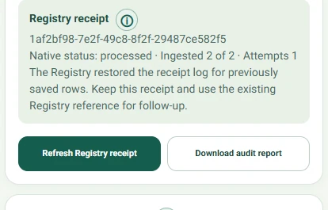

# Maintain the illustrated NSIPA guides

The November 2026 release contains 219 distinct sandbox screenshots placed in 449 guides, 38 process diagrams across 29 service chapters and related tasks, and two illustrations of household registration and independent review. The screenshots use demonstration records. Some Data Imports examples replay recorded workflow states in the sandbox interface.

## How readers use a screenshot

Each screenshot sits beside the instruction or paragraph it explains. A caption identifies the control or outcome to look for. On a phone, readers can tap **Enlarge screenshot**, select **Actual size** to inspect details, and select **Close** to return to the same step. Keyboard users can press Escape. With JavaScript disabled, the screenshot link opens the full image.

For example, a restored Registry receipt keeps the original reference. The guide shows where to find the reference, the restoration event and the audit download. [Read the receipt guide](https://docs.g2p.wverve.in/topics/imports/receipt-log-restored/)



## Add or replace a screenshot

1. Reproduce the relevant step using a demonstration record and the role named in the guide. Capture the action or result the reader needs to recognise. Crop out browser chrome and unrelated controls. Inspect the full image for personal details or credentials before committing a public asset.
2. Save the full capture as `visuals/<key>.webp`. If scaling it to phone width makes the control illegible, capture the phone layout or crop it around the control. Save that version as `visuals/<key>-phone.webp`. The viewer opens the full capture from either version.
3. Add the key under `screens` in [screenshots.json](screenshots.json). Supply a plain-language `caption` and the actual pixel `width` and `height`. For a phone version also set `phone` to its `[width, height]`. The caption also provides the image's text alternative.
4. Under `topics`, find the guide by its published article slug. Use the **exact instruction line** as the key and an ordered list of screenshot keys as its value. Put the clearest example first. If the image explains the whole article, use `@purpose`. For a service chapter, use the chapter ID under `chapters` and the exact paragraph from [pages.json](pages.json).
5. Rebuild and open the affected step. If editorial wording changes, update the matching instruction or paragraph in the catalogue too. An unmatched placement is omitted, so a successful build alone cannot confirm that a revised instruction still has its screenshot.

## Edit a diagram or illustration

Each item in [diagrams.json](diagrams.json) has a title and a list of `[short label, explanation]` pairs. Use an ordered sequence for a workflow, or `"parallel": true` for independent options. Use the service chapter ID for its main diagram. Assign a task-specific diagram in `GuideVisuals.topic_diagram` when the reader needs a more specific explanation. Labels and explanations are HTML text and stack in a narrow column. [Rendering and topic selection](visual_guides.py)

The illustrations use the asset keys `household-interview` and `independent-review`. Each has a full and phone WebP. The descriptions and page placements are in [build.py](build.py). The phone source is selected at viewport widths up to 600 pixels. If an illustration's aspect ratio changes, update its declared dimensions in the renderer.

## Preview and check a change

From this directory, run the following with Python 3.10 or later in Bash. The preview uses the repository's published-content seed and a new temporary directory.

```bash
PREVIEW=$(mktemp -d)
python3 build.py "$PREVIEW" --prefix= --origin http://127.0.0.1:8000
python3 -m http.server 8000 --bind 127.0.0.1 --directory "$PREVIEW"
```

Open `http://127.0.0.1:8000/`. The builder checks guide text, internal links, anchors, full and phone image paths, search, canonical URLs and the sitemap. For the 23 November seed, expect 598 pages. Stop the preview with Ctrl+C.

| Page to check | What to verify |
| --- | --- |
| `/household-registration/` | At 320 pixels wide, the illustration fits, the diagram stacks and the page needs no sideways scrolling. |
| `/topics/imports/receipt-log-restored/` | Find the receipt beneath its instruction. Open the additional screenshots, enlarge one, select **Actual size**, then close it. Keyboard focus should return to the same image link. |
| `/payment-and-reconciliation/` | Check the role labels and the report at both phone and desktop widths. The counts and reference named by the caption should be visible in the enlarged image. |

## Publish a visual update

Stage a fresh release with the destination host configuration. Build from the destination's anonymous published feed when it has local editorial revisions. The release preparer copies the WebPs into the staged source, and the builder emits them under `assets/visuals/`. Deploy the complete generated site so its HTML, images, script and stylesheet come from the same revision. Use the existing release switch to roll back if needed. [Ooru staging, publishing and rollback](../../docs/current/OORU-DOCS-HELP-INSTALL.md)
